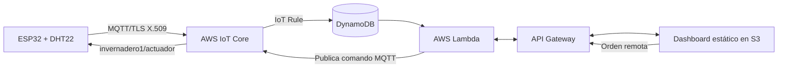

# Práctica 3 | AWS IoT Core, DynamoDB y dashboard en S3

**Asignatura:** Inteligencia Artificial Aplicada a Internet de las Cosas  
**Docente:** Jhorman Andrés Villanueva Vivas  
**Equipo:** Natalia Hernández Piedrahita, Sidney Leonardo Leusson Angulo, José Fernando Luque Cajiao y Jarvin David Alvarado Garcés

[Checklist de entrega](checklist-entrega.md) · [Evidencias](evidencias/README.md) · [Informe y entregables](entregables.md) · [Volver al proyecto](../README.md)

Esta práctica desarrolla el caso de monitoreo de **temperatura y humedad relativa del aire** de un invernadero de tomates. El código conecta un ESP32 con DHT22 a AWS IoT Core por MQTT con certificados X.509, dirige mensajes a DynamoDB, expone consultas y órdenes mediante Lambda y API Gateway, y presenta un dashboard estático en S3. La carpeta contiene la implementación y una verificación fechada del despliegue. El origen físico de la publicación MQTT y la ejecución de una orden por el actuador requieren una demostración adicional; el [checklist](checklist-entrega.md) separa lo implementado de lo acreditado.

## Recorrido de datos y órdenes



El tópico de lecturas es `invernadero1/telemetria`; el de comandos, `invernadero1/actuador`. La API puede publicar una orden, pero la respuesta HTTP por sí sola no demuestra que el ESP32 la recibió. Los indicadores agronómicos del código son cálculos y reglas de demostración; sus porcentajes de riesgo **no son probabilidades clínicas o agronómicas validadas** ni acreditan un modelo entrenado.

## Archivos principales

| Ruta | Función |
| --- | --- |
| [esp32/esp32_serverless/](esp32/esp32_serverless/) | Firmware y plantilla pública de credenciales; las claves reales no deben subirse. |
| [infra/deploy_serverless.py](infra/deploy_serverless.py) | Preparación de recursos en AWS Academy Learner Lab. |
| [lambda/](lambda/) | Consulta de lecturas, generación CSV, publicación de órdenes y pruebas unitarias. |
| [s3-dashboard/index.html](s3-dashboard/index.html) | Interfaz estática con gráficas, controles y descarga CSV. |
| [evidencias/](evidencias/README.md) | Resultado AWS del 3 de noviembre de 2026 y límites de esa prueba. |
| [checklist-entrega.md](checklist-entrega.md) | Correspondencia con el enunciado y recorrido para una nueva demostración. |
| [entregables.md](entregables.md) | Informe, archivos para mostrar y enlace general del proyecto. |

## Reproducir y demostrar

1. Consultar el [enunciado y checklist](checklist-entrega.md). La infraestructura de AWS Academy puede caducar; confirmar primero que el laboratorio esté activo y revisar los recursos y posibles cargos antes de ejecutar el despliegue.
2. Instalar las dependencias indicadas en [lambda/requirements.txt](lambda/requirements.txt) y ejecutar las pruebas locales:

   ```bash
   python -m unittest discover -s practica-3/lambda -p 'test_*.py'
   ```

3. Con credenciales temporales de AWS Academy, revisar y ejecutar [infra/deploy_serverless.py](infra/deploy_serverless.py). No publicar `credentials.h`, certificados privados, contraseñas ni capturas que los muestren. El archivo [credentials.example.h](esp32/esp32_serverless/credentials.example.h) es solo una plantilla.
4. Configurar el ESP32 en un entorno privado, cargar el firmware y verificar en el monitor serial la conexión a AWS IoT Core. Identificar una lectura nueva por dispositivo, hora y valor. Compararla con el mensaje de IoT Core, el registro de DynamoDB y el dashboard.
5. Descargar el CSV del dashboard y verificar que contiene esa misma lectura. Después enviar Encender, Apagar y Automático y observar la recepción del comando y la salida del actuador en el ESP32. Guardar capturas o registro serial sin secretos.
6. Registrar fecha, cuenta o laboratorio, resultados y límites en una nueva evidencia dentro de [evidencias/](evidencias/README.md). No reemplazar la prueba histórica del 3 de noviembre.

La [evidencia publicada](evidencias/EVIDENCIA_AWS_SERVERLESS_2026-11-03.md) registra una publicación MQTT con certificado que llegó a DynamoDB, una respuesta de consulta y la publicación de un comando por la API. No documenta por sí misma el recorrido completo desde un ESP32 físico ni una descarga CSV examinada. La presentación y la entrega oficial se comprueban por separado en el curso.

## Si una prueba falla

| Síntoma | Revisión inicial |
| --- | --- |
| El ESP32 no conecta | Wi-Fi, hora/certificados, endpoint ATS, política IoT y puerto 8883. Evitar mostrar la clave privada. |
| IoT Core recibe, pero DynamoDB no | Tópico exacto, regla SQL, permisos de escritura, clave de tabla y registros de error de la regla. |
| El dashboard muestra valores antiguos | Estado del laboratorio, URL de API Gateway, respuesta de `/sensor` y hora de la última lectura. No sustituir datos faltantes por datos semilla. |
| El botón devuelve éxito, pero no cambia la salida | Suscripción del ESP32 a `invernadero1/actuador`, mensaje recibido, modo, cableado y estado del actuador. |
| No descarga CSV | Probar `/sensor?format=csv`, encabezados, navegador y respuesta de la API. |

El [tablero de GitHub Pages](https://nathernandez1189.github.io/savia-iot/) corresponde a otra publicación del proyecto. Para acreditar esta práctica se debe mostrar el **sitio de S3** conectado a su API, además de la ruta de almacenamiento en DynamoDB.
