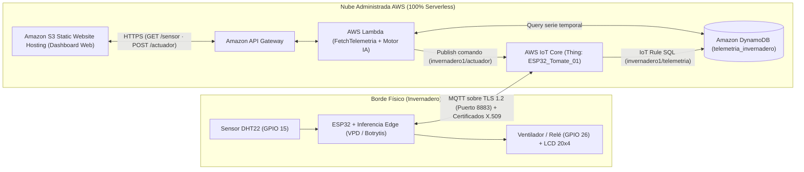

# Práctica 3 — Arquitectura 100% Serverless + IA Agronómica en AWS

Evolución final de la infraestructura **Savia IoT** hacia un modelo 100% administrado y sin servidores (*Serverless*) en AWS, integrando un **Motor de Inteligencia Artificial Agronómica** en el borde (ESP32) y en la nube (AWS Lambda) para el monitoreo y control predictivo de un invernadero de tomates (*Solanum lycopersicum*).

---

## 1. Diagrama de Arquitectura Serverless



---

## 2. Componentes y Especificaciones Técnicas

| Capa | Servicio AWS / Componente | Configuración Técnica |
| :--- | :--- | :--- |
| **1. Dispositivo e Ingesta Segura** | ESP32 + **AWS IoT Core** | Librería `WiFiClientSecure` en puerto `8883/TCP`. Autenticación mutua X.509 (`AmazonRootCA1.pem`, `device.pem.crt`, `private.pem.key`) aislada en [`credentials.h`](esp32/esp32_serverless/credentials.example.h). Objeto Thing: `ESP32_Tomate_01`. |
| **2. Enrutamiento Sin Servidor** | **AWS IoT Rule** (`ReglaInvernaderoDynamo`) | Sentencia SQL: `SELECT device_id, timestamp, temperatura, humedad, actuador_fan, modo, vpd_kpa, riesgo_botrytis FROM 'invernadero1/telemetria'`. Inserción directa en DynamoDB vía `LabRole`. |
| **3. Persistencia NoSQL** | **Amazon DynamoDB** (`telemetria_invernadero`) | Esquema sin servidor (*On-Demand* `PAY_PER_REQUEST`). **Partition Key:** `device_id` (`String`), **Sort Key:** `timestamp` (`Number`). |
| **4. Backend + Motor de IA** | **AWS Lambda** (`FetchTelemetria`) + **Amazon API Gateway** | Runtime Python 3.12 (`LabRole`). Expone `GET /sensor` (consulta DynamoDB + inferencia IA + exportación CSV) y `POST /actuador` (publicación MQTT hacia `invernadero1/actuador`). |
| **5. Visualización y Control** | **Amazon S3** (*Static Website Hosting*) | Hospeda [`s3-dashboard/index.html`](s3-dashboard/index.html) con gráficas Chart.js, diagnóstico predictivo IA, descarga de archivo `.csv` y botones de encendido/apagado remoto del ventilador. |

---

## 3. Inteligencia Artificial Aplicada al Cultivo de Tomate

Sin requerir sensores físicos adicionales, el sistema procesa las series de temperatura y humedad del DHT22 en dos niveles:

1. **Biofísica Vegetal (Ecuación de Magnus-Tetens):**
   - Calcula el **Déficit de Presión de Vapor ($VPD$ en kPa)** y el **Punto de Rocío ($T_{dew}$ en °C)**. El rango óptimo de transpiración del tomate se ubica entre $0.8$ y $1.5\text{ kPa}$.
2. **Pronóstico Microclimático a Corto Plazo (+15 y +30 min):**
   - Regresión lineal por mínimos cuadrados sobre la ventana móvil almacenada en DynamoDB para proyectar la temperatura futura y estimar el **tiempo restante hasta estrés térmico ($>30\text{ }^\circ\text{C}$)** (*Time-to-Stress*).
3. **Clasificador de Riesgo Fitopatológico (*Botrytis cinerea* y Estrés Floral):**
   - Estima de $0$ a $100\%$ la probabilidad de condensación foliar para moho gris (*Botrytis*) cuando la humedad supera $75\%$ y $T - T_{dew} < 3.5\text{ }^\circ\text{C}$, y el riesgo de aborto floral cuando $T > 30\text{ }^\circ\text{C}$.
4. **Detección de Anomalías en Vivo ($Z$-Score Adaptativo):**
   - Detecta desviaciones abruptas ($|Z| \ge 2.2\sigma$) respecto a la ventana reciente, permitiendo demostrar la detección en vivo durante la sustentación al aplicar calor al sensor DHT22.

---

## 4. Estructura de Archivos

```text
practica-3/
├── README.md                                    # Este documento
├── esp32/
│   └── esp32_serverless/
│       ├── esp32_serverless.ino                 # Firmware ESP32 con mTLS X.509 + Edge AI + LCD 20x4
│       └── credentials.example.h                # Plantilla pública de certificados (credentials.h está en .gitignore)
├── lambda/
│   ├── lambda_function.py                       # Función AWS Lambda FetchTelemetria + Motor IA
│   ├── test_lambda.py                           # Pruebas unitarias (5 tests)
│   └── requirements.txt                         # Dependencias Python
├── s3-dashboard/
│   └── index.html                               # Dashboard estático para Amazon S3 (Chart.js + CSV + Control)
└── infra/
    └── deploy_serverless.py                     # Despliegue automatizado en AWS Academy Learner Lab
```

---

## 5. Guía Paso a Paso de Despliegue y Demostración

### Paso 1: Ejecutar Pruebas Unitarias Locales
```bash
python -m unittest discover -s practica-3/lambda -p "test_*.py"
```

### Paso 2: Aprovisionar toda la Infraestructura en AWS Academy
1. En **AWS Academy Learner Lab**, inicia el laboratorio (*Start Lab*) y abre **AWS Details $\rightarrow$ Show** para copiar tus credenciales temporales (`aws_access_key_id`, `aws_secret_access_key`, `aws_session_token`).
2. Configúralas en tu terminal o en `~/.aws/credentials` y ejecuta:
   ```bash
   python practica-3/infra/deploy_serverless.py
   ```
3. El script creará automáticamente:
   - La tabla DynamoDB `telemetria_invernadero` con datos semilla iniciales.
   - El objeto `ESP32_Tomate_01`, su política y certificados X.509 en AWS IoT Core.
   - El archivo `practica-3/esp32/esp32_serverless/credentials.h` con tus certificados reales.
   - La regla SQL `ReglaInvernaderoDynamo`.
   - La función Lambda `FetchTelemetria` y el API Gateway `SaviaServerlessAPI`.
   - El bucket S3 público con el Dashboard ya conectado a tu URL de API Gateway.

### Paso 3: Cargar el Firmware en el ESP32 Físico
1. Abre [`practica-3/esp32/esp32_serverless/esp32_serverless.ino`](esp32/esp32_serverless/esp32_serverless.ino) en **Arduino IDE**.
2. Verifica que `credentials.h` esté en la misma carpeta con tu `WIFI_SSID` y `WIFI_PASSWORD`.
3. Sube el sketch al ESP32. En el Monitor Serie (`115200` baudios) verás:
   `Conectando a AWS IoT Core (mTLS X.509 8883)... CONECTADO!`
   y en la pantalla LCD física aparecerá `IOT TLS OK`.

---

## 6. Checklist para la Sustentación con el Docente

| Criterio | Cómo demostrarlo en vivo |
| :--- | :--- |
| **1. Ingesta y Seguridad X.509** | En consola AWS $\rightarrow$ *IoT Core $\rightarrow$ MQTT test client*, suscribirse a `invernadero1/telemetria` y mostrar los JSON llegando desde el ESP32 por el puerto 8883. |
| **2. Persistencia NoSQL** | En consola AWS $\rightarrow$ *DynamoDB $\rightarrow$ Tables $\rightarrow$ `telemetria_invernadero` $\rightarrow$ Explore table items*, mostrar las lecturas almacenadas por la IoT Rule. |
| **3. Dashboard en Amazon S3** | Abrir la URL pública del bucket S3 (`http://savia-iot-serverless-....s3-website-us-east-1.amazonaws.com`) y mostrar las tarjetas, gráficas y el **Diagnóstico Predictivo IA**. |
| **4. Exportación a CSV** | Hacer clic en el botón **"CSV"** del Dashboard S3 y abrir el archivo `.csv` descargado. |
| **5. Control Remoto de Actuador** | Hacer clic en **"Automático"**, **"Encender"** o **"Apagar"** en el Dashboard S3 y mostrar cómo cambia la pantalla LCD y el LED/relé del ESP32 físico. |
| **6. Código y Documentación** | Mostrar este repositorio con `credentials.example.h` limpio y las pruebas en verde en GitHub Actions. |
