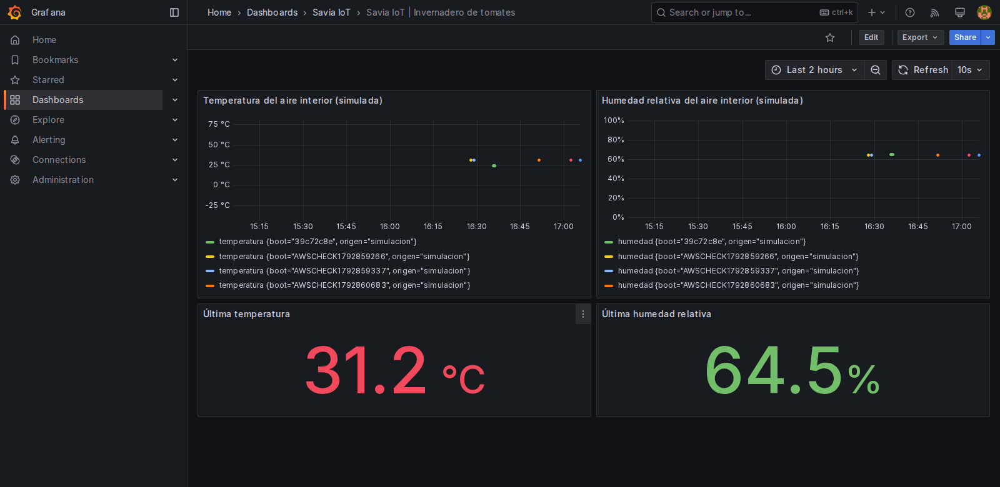

# Práctica 2: verificación en AWS Academy — 24 de octubre de 2026

**Proyecto:** Savia IoT, monitoreo y ventilación simulada de un invernadero de tomates.  
**Asignatura:** Inteligencia Artificial Aplicada a Internet de las Cosas.  
**Docente:** Jhorman Andrés Villanueva Vivas.  
**Equipo:** Natalia Hernández Piedrahita, Sidney Leonardo Leusson Angulo, José Fernando Luque Cajiao y Jarvin David Alvarado Garcés.

## Infraestructura observada

Se reutilizó la instancia Ubuntu de AWS Academy Learner Lab de la Práctica 1 (`i-01f3188a0db02ef65`), ampliada a `t3.small` dentro del límite de gasto autorizado. La aplicación anterior continuó respondiendo `HTTP 200` en `/health`. En `/opt/savia-iot-practica2` se instalaron Docker y Compose. En la primera fase estuvieron activos Mosquitto, colector, InfluxDB OSS 2 y Grafana en esa VM. El puerto MQTT 1883 se abrió temporalmente para la demostración; desde AWS CloudShell se confirmó una conexión TCP a ese puerto público. El broker exige usuario y contraseña y aplica listas de acceso por tópico. La base PostgreSQL de la Práctica 1 sigue siendo un recurso distinto y privado.

Para cumplir el numeral de separación de la base, se creó la pila CloudFormation `savia-influx-practica2` en estado `CREATE_COMPLETE`: una **segunda subred pública `10.42.2.0/24`**, una instancia Ubuntu `t3.micro` (`i-0776ae9f448d91887`) y un grupo de seguridad que permite 8086/TCP **solo desde el grupo de la VM principal**. La segunda VM tiene la dirección privada `10.42.2.106`; su servicio InfluxDB OSS 2 respondió `status: pass` y la VM principal alcanzó su `/health` por la VPC. El token de InfluxDB se guardó como parámetro cifrado de AWS Systems Manager y la VM principal lo obtuvo mediante su rol, sin incorporarlo al repositorio. La subred es pública por su ruta y asignación de IP; **el puerto de la base no es de acceso público**.

## Recorrido de una lectura de prueba

La prueba reproducible está en [`smoke_test.sh`](smoke_test.sh). Publicó desde la propia VM, mediante un **cliente MQTT de prueba autenticado**, un mensaje identificado como `AWSCHECK1792859337`: temperatura **31,2 °C**, humedad **64,5 %** y ventilación encendida. El registro apareció en `readings.csv` y en la cola SQLite. El colector confirmó posteriormente `sent=1`; una consulta de InfluxDB devolvió puntos del mismo identificador con la etiqueta `origen=simulacion`. La primera consulta se hizo mientras la lectura seguía en la cola (`sent=0`), por lo que se repitió y se corrigió el script para esperar confirmación antes de declarar éxito. La ejecución definitiva terminó con código 0.

## Prueba del ESP32 simulado

En la [simulación de la Práctica 2](https://wokwi.com/projects/478779944323491841), el ESP32 compiló, se conectó a `Wokwi-GUEST` y el monitor serial mostró **«MQTT AWS autenticado»** y lecturas **«Enviado #1» a «Enviado #7»** de un DHT22 simulado: 24,0 °C, 65,0 % de humedad y ventilación apagada. La secuencia de ese arranque, `39c72c8e`, apareció en el CSV de AWS hasta la lectura 7. La consulta directa `python3 verify_influx.py 39c72c8e` devolvió **14 puntos**: temperatura y humedad para las siete lecturas. El identificador de arranque y la secuencia distinguen esta comprobación de la publicación sintética `AWSCHECK...` anterior.

Para realizar esa prueba se configuraron temporalmente la IP y la clave del usuario `savia_device` en el editor de Wokwi, con autorización de la titular. Al terminar se detuvo la simulación, se recargó el proyecto público y se comprobó que la versión guardada contenía de nuevo el marcador `CAMBIAR_POR_CLAVE_TEMPORAL`. En AWS se ejecutó `rotate_device_password.py`: la nueva clave fue aceptada y la clave anterior rechazada. **El enlace compartido no contiene la clave funcional.** Para repetir la demostración se debe configurar una credencial temporal nueva.

Grafana respondió por su API y mostró una alerta de temperatura superior a 30 °C en estado **active**, con receptor **Savia MQTT**. Esa activación corresponde a la lectura sintética de 31,2 °C; las lecturas posteriores de Wokwi eran de 24,0 °C. El tablero y la notificación por el tópico `invernadero1/alertas` ya se habían verificado en la [prueba local](EVIDENCIA_LOCAL_2026-10-24.md). En AWS se verificó la regla activa y su receptor configurado; **no se capturó una nueva notificación recibida en AWS** durante esta comprobación.

## Traslado y verificación de la base separada

En la VM principal se configuraron el colector y la fuente de datos de Grafana para `http://10.42.2.106:8086`. El historial de **nueve lecturas** de la cola se reenvió a la nueva base con sus marcas de tiempo originales. Después, `verify_influx.py 39c72c8e` encontró las lecturas del ESP32 simulado en la **nueva** InfluxDB. Una prueba sintética adicional (`AWSCHECK1792860683`) se publicó por MQTT y se confirmó tanto en CSV como en InfluxDB (`sent=1`, consulta con puntos). La fuente aprovisionada de Grafana apuntó a `10.42.2.106:8086` y su API respondió correctamente. Se detuvo el contenedor de InfluxDB de la primera VM: allí siguieron activos Mosquitto, colector y Grafana, mientras la base quedó activa en la segunda. La aplicación de la Práctica 1 continuó con `/health` correcto y PostgreSQL como base propia.

## Captura del tablero en AWS

Se abrió el Grafana privado desde la propia VM y se guardó [esta captura del tablero](evidencias/grafana-aws-2026-10-24.png). Aparecen las cuatro tarjetas: serie de temperatura, serie de humedad, última temperatura y última humedad. Las series incluyen el arranque `39c72c8e` del ESP32 **simulado en Wokwi** (24 °C, 65 %) y lecturas `AWSCHECK...` enviadas por un cliente MQTT de prueba. La última lectura visible (31,2 °C y 64,5 %) es **sintética**; no se presenta como medición física ni como lectura del DHT22 de Wokwi. Para que las tarjetas de valor actual mostraran un único dato, su consulta se agrupó y ordenó por fecha antes de seleccionar el último punto. La imagen no expone credenciales.

## Alcance y pasos restantes

Los sensores y el cultivo son simulados; no se registró una medición física. La conexión del ESP32 con AWS quedó comprobada en una sesión, no su disponibilidad permanente. El tablero de Grafana quedó verificado mediante la API, la consulta a InfluxDB y la captura visual anterior. La notificación por MQTT está comprobada localmente; no se documentó una nueva recepción en AWS. La sustentación y el envío formal al campus corresponden al equipo.

La separación en una segunda subred pública se implementó con una segunda VM; no se presenta como una base administrada de AWS. El acceso MQTT abierto y las dos VM deben retirarse o reducirse tras la demostración prevista hasta el **1 de noviembre de 2026**, según el límite de gasto del equipo. El presupuesto de AWS puede reflejar cargos con retraso, por lo que esa fecha no es una garantía automática de costo.
