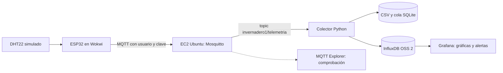

# Práctica 2 | Broker MQTT, InfluxDB y Grafana

**Asignatura:** Inteligencia Artificial Aplicada a Internet de las Cosas
**Docente:** Jhorman Andrés Villanueva Vivas
**Equipo:** Natalia Hernández Piedrahita, Sidney Leonardo Leusson Angulo, José Fernando Luque Cajiao y Jarvin David Alvarado Garcés

Esta carpeta prepara una **segunda implementación** para el mismo caso del invernadero de tomates. La [Práctica 1](../README.md) y su Wokwi público se conservan. Aquí el ESP32 simulado usa un broker Mosquitto propio con autenticación; un colector valida cada mensaje, lo deja en CSV y lo escribe en InfluxDB. Grafana lee InfluxDB. Los datos son del simulador, no de un cultivo real.



El dispositivo publica además `invernadero1/temperatura` y `invernadero1/humedad` para que los tópicos de cada variable puedan verse en un cliente MQTT. El colector consume el JSON completo de `invernadero1/telemetria`, identificado por `boot` y `seq`; así evita emparejar por error mensajes independientes. Guarda primero una cola local y el CSV, y reintenta InfluxDB si este se interrumpe. InfluxDB y Grafana escuchan solo en `127.0.0.1` del host. La única puerta nueva prevista hacia el simulador es MQTT 1883 con autenticación; se usa exclusivamente para esta demostración y no para dispositivos reales.

## Preparación en Ubuntu con Docker

Desde `practica2/`:

```bash
bash setup.sh
docker compose config --quiet
docker compose up -d --build
docker compose ps
```

El script genera claves aleatorias en `.env` y un archivo de contraseñas de Mosquitto en `.secrets/`. Ambos están ignorados por Git. **No compartir capturas de esos valores.** El archivo `.env.example` muestra los nombres de configuración sin claves funcionales. Para acceder a Grafana desde el propio servidor: `http://127.0.0.1:3000`. Para verlo desde otro computador se puede usar un túnel SSH, sin abrir el puerto 3000 al público:

MQTT queda limitado a `127.0.0.1` en pruebas locales. Para recibir mensajes de Wokwi en una VM, agregar `MQTT_BIND_HOST=0.0.0.0` al `.env` privado de esa VM y permitir 1883/TCP en su grupo de seguridad durante la demostración.

```bash
ssh -L 3000:127.0.0.1:3000 ubuntu@IP_PUBLICA
```

Luego abrir `http://127.0.0.1:3000` en ese computador. El tablero **Savia IoT | Invernadero de tomates** queda aprovisionado; sus cuatro paneles muestran temperatura y humedad del aire interior simulado. InfluxDB también queda local en el puerto 8086. La clave de Grafana se consulta en el `.env` privado del servidor.

## Configurar el ESP32 de la Práctica 2

Crear una **copia distinta** del circuito de Wokwi con [diagram.json](wokwi/diagram.json), [sketch.ino](wokwi/sketch.ino) y [libraries.txt](wokwi/libraries.txt). En el sketch, poner la dirección de la VM y la clave temporal `MQTT_DEVICE_PASSWORD` del `.env` privado. **No publicar ni compartir el enlace de esa copia mientras contenga la clave**, porque el editor de Wokwi la mostraría a quien pueda abrirlo. Rotar la clave después de la demostración. El broker debe ser alcanzable por la pasarela pública de Wokwi; la documentación de Wokwi advierte que ese tráfico puede supervisarse, por lo que esta modalidad no transporta datos privados ni controla cargas físicas.

En AWS, comprobar el grupo de seguridad antes de abrir 1883/TCP; mantener SSH restringido y no abrir 3000 ni 8086. El montaje puede ejecutarse en la EC2 de la Práctica 1 **si la memoria y el espacio disponible lo permiten**, sin crear una VM adicional. La base InfluxDB estaría en esa misma instancia pública pero su puerto no sería público. El numeral 6 del enunciado dice que la base debe estar en una subred pública, mientras que el ejercicio anterior exigía una privada; esta topología debe aclararse con el docente antes de afirmar que se cumple esa condición particular.

## Comprobaciones para la entrega

1. `docker compose ps`: Mosquitto, InfluxDB, colector y Grafana activos.
2. Desde MQTT Explorer, conectar a la IP de AWS en 1883 con el usuario temporal y comprobar `invernadero1/#`. Los mensajes sin usuario/clave deben ser rechazados.
3. Iniciar Wokwi y confirmar `MQTT AWS autenticado` en el monitor serial. Variar temperatura y humedad del DHT22.
4. `docker compose logs --tail=40 collector`: lecturas recibidas y enviadas a InfluxDB. Exportar CSV con `docker compose cp collector:/data/readings.csv ./lecturas-demostracion.csv` (no subir datos privados ni contraseñas).
5. En Grafana, abrir el tablero y verificar los puntos del mismo período. La regla aprovisionada avisa cuando la temperatura supera 30 °C; el contacto publica la notificación en `invernadero1/alertas`. Comprobar que se recibe realmente, además de mirar el estado de la regla. Una futura regla de humedad requerirá su propia prueba antes de presentarla como realizada.
6. Guardar capturas del circuito, MQTT Explorer, CSV, consulta InfluxDB, paneles y alerta/notificación. Compartir el repositorio y exponer el recorrido.

**Estado documentado (24 de octubre de 2026):** la pila completa se ejecutó en Docker local. Se comprobó una publicación MQTT autenticada con un cliente de prueba, el paso por el colector, CSV, InfluxDB, consulta de Grafana y una notificación MQTT de temperatura alta. Estos mensajes de prueba **no salieron del ESP32**. La conexión de la copia Wokwi con el broker de AWS y el despliegue en el laboratorio aún deben verificarse allí. Véase [evidencia local](EVIDENCIA_LOCAL_2026-10-24.md). En CampusDigital se observó cierre de la actividad el **31 de octubre de 2026 a las 12:00** (hora de Colombia); confirmar cualquier cambio directamente en el curso.
