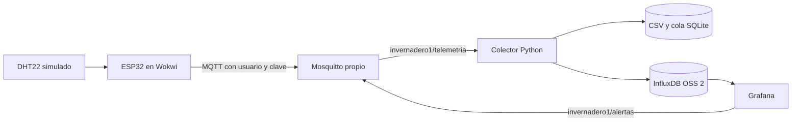

# Práctica 2 | Broker MQTT, InfluxDB y Grafana

**Asignatura:** Inteligencia Artificial Aplicada a Internet de las Cosas

**Docente:** Jhorman Andrés Villanueva Vivas

**Equipo:** Natalia Hernández Piedrahita, Sidney Leonardo Leusson Angulo, José Fernando Luque Cajiao y Jarvin David Alvarado Garcés

[Checklist de entrega](checklist-entrega.md) · [Evidencias](evidencias/README.md) · [Presentación descargable](entregables.md) · [Volver al proyecto](../README.md)

Esta práctica continúa el monitoreo del invernadero de tomates con **Mosquitto propio, autenticación, un colector Python, InfluxDB y Grafana**. El ESP32 y el DHT22 se simulan en Wokwi; el LED representa ventilación. El control local enciende el LED por encima de 30 °C, lo apaga por debajo de 27 °C y conserva su estado entre ambos límites.

La carpeta mantiene el nombre `practica2/`. La [Práctica 1](../practica-1/README.md) tiene su propia guía, servidor y conexión MQTT pública. El [tablero de GitHub Pages](https://nathernandez1189.github.io/savia-iot/) corresponde a esa conexión; el panel de esta práctica es **Grafana**.

## Recorrido de los datos



| Componente | Función en la práctica | Archivo principal |
| --- | --- | --- |
| ESP32 y DHT22 | Medir el aire simulado, controlar el LED y publicar cada 5 segundos | [wokwi/sketch.ino](wokwi/sketch.ino) |
| Mosquitto | Recibir mensajes y limitar operaciones por usuario y tópico | [mosquitto.conf](mosquitto.conf), [mosquitto.acl](mosquitto.acl) |
| Colector Python | Validar, deduplicar por `boot` y `seq`, guardar y reintentar InfluxDB | [collector.py](collector.py) |
| CSV y SQLite | Archivo de lecturas y cola persistente del colector | `/data/readings.csv`, `/data/outbox.sqlite3` dentro del colector |
| InfluxDB | Base de datos de series temporales de esta práctica | [compose.yaml](compose.yaml), [plantilla AWS](aws/influx-public-subnet.yaml) |
| Grafana | Consultar InfluxDB, mostrar cuatro paneles y generar alertas | [grafana/](grafana/) |

El colector recibe el JSON completo de `invernadero1/telemetria`. El ESP32 publica también temperatura y humedad en tópicos separados; el colector no necesita emparejar esos mensajes. SQLite sirve como cola de entrega; InfluxDB es la base que consulta Grafana. PostgreSQL corresponde al despliegue AWS de la Práctica 1.

## Organización de la carpeta

- [checklist-entrega.md](checklist-entrega.md): qué está implementado y qué comprobar antes de exponer.
- [evidencias/](evidencias/README.md): resultados locales y AWS del 24 de octubre de 2026 y captura de Grafana.
- [entregables.md](entregables.md): descarga de la presentación original en Releases.
- [wokwi/](wokwi/): circuito y firmware sin claves funcionales.
- [grafana/](grafana/): paneles, fuente de datos y alerta aprovisionados.
- [aws/](aws/): plantilla de la segunda EC2 y su subred.
- En esta carpeta: Compose, configuración de Mosquitto, colector y herramientas de preparación y comprobación. Se conservan aquí para mantener las rutas de ejecución.

## 1. Preparar una instalación local

Se necesita Docker con Compose v2, Python 3 y Bash. Los comandos se ejecutan en una terminal de Ubuntu o macOS con Docker disponible. Desde la raíz del repositorio:

```bash
cd practica2
bash setup.sh
docker compose config --quiet
docker compose up -d --build
docker compose ps
```

**Resultado esperado:** cuatro servicios activos: `mosquitto`, `collector`, `influxdb` y `grafana`. El script crea claves aleatorias en `.env` y contraseñas de Mosquitto en `.secrets/`; ambos están excluidos de Git. Los nombres de las variables están en [.env.example](.env.example).

Ejecutar `setup.sh` solo la primera vez: si encuentra configuración privada, se detiene para conservarla. En una instalación existente, continuar con Compose y las credenciales originales. No sustituir `.env` por los marcadores del ejemplo ni mostrarlo al compartir pantalla.

| Servicio | Puerto TCP | Acceso local definido en Compose |
| --- | --- | --- |
| Mosquitto | 1883 | `127.0.0.1:1883`, con usuario y contraseña |
| InfluxDB | 8086 | [http://127.0.0.1:8086](http://127.0.0.1:8086) |
| Grafana | 3000 | [http://127.0.0.1:3000](http://127.0.0.1:3000) |

Para Grafana, usar `GRAFANA_USER` y `GRAFANA_PASSWORD` de la configuración privada. Abrir **Dashboards → Savia IoT → Savia IoT | Invernadero de tomates**. Sin lecturas recientes, es normal que aparezca “No data”.

### Comprobar la pila con un dato de prueba

```bash
bash smoke_test.sh
```

El script publica **un dato sintético** de 31,2 °C y 64,5 % HR, comprueba el CSV, espera confirmación de InfluxDB y consulta sus puntos. Imprime un identificador `AWSCHECK...`. Esta prueba puede activar la alerta de temperatura y acredita el recorrido desde el cliente de prueba; para demostrar el sensor simulado, completar la siguiente sección.

## 2. Conectar Wokwi al broker de la Práctica 2

Abrir la [simulación pública de la Práctica 2](https://wokwi.com/projects/478779944323491841). Tiene ESP32, DHT22 y LED; `MQTT_HOST` y `MQTT_PASSWORD` son marcadores deliberados. Su ejecución sin configurar conserva el control local, pero no conecta con AWS.

1. Confirmar la IP pública **vigente** de la EC2 principal y que Mosquitto esté activo. No reutilizar una IP histórica sin comprobarla.
2. En el `.env` privado de esa VM, configurar `MQTT_BIND_HOST=0.0.0.0` para la demostración y aplicar con `docker compose up -d mosquitto`. El grupo de seguridad debe permitir el tráfico TCP 1883 que llega desde la pasarela de Wokwi. Los puertos de InfluxDB y Grafana conservan sus restricciones.
3. En un entorno de simulación privado, configurar ese host, el puerto 1883, el usuario `savia_device` y su clave temporal. **No guardar ni publicar credenciales funcionales en el proyecto público.** El acceso local por `127.0.0.1` no permite, por sí solo, que Wokwi en la nube llegue al computador.
4. Iniciar y buscar **“MQTT AWS autenticado”** y **“Enviado #…”** en el monitor serial. Cambiar a 32 °C y después a 26 °C para comprobar el LED y la recepción de lecturas.
5. Al terminar la demostración, retirar la clave de la copia del simulador y ejecutar en el servidor `python3 rotate_device_password.py`. El script reinicia Mosquitto y comprueba la nueva clave; coordinar este paso al finalizar las pruebas del equipo porque interrumpe las conexiones.

El puerto 1883 de esta configuración usa MQTT sin TLS: la autenticación y las listas de acceso no cifran el transporte. Esta modalidad está limitada a la demostración de datos simulados con credenciales temporales.

### Usuarios y permisos MQTT

La [lista de acceso](mosquitto.acl) define permisos distintos:

| Usuario | Permiso |
| --- | --- |
| `savia_device` | Publicar en `invernadero1/telemetria`, `invernadero1/temperatura` y `invernadero1/humedad` |
| `savia_collector` | Leer `invernadero1/telemetria` |
| `savia_alerts` | Publicar y leer `invernadero1/alertas` |

Para mostrar telemetría en MQTT Explorer, usar las credenciales privadas del colector y suscribirse a su tópico autorizado. Para mostrar notificaciones, usar las del usuario de alertas. La cuenta del dispositivo solo publica; conectarse con ella no autoriza leer todos los tópicos. Los accesos anónimos están deshabilitados.

## 3. Mostrar el colector, la base y Grafana

Desde esta carpeta en el servidor que recibe los mensajes:

```bash
docker compose logs --tail=40 collector
docker compose exec -T collector tail -n 6 /data/readings.csv
```

Tomar el `boot` y la secuencia de una lectura nueva desde el mensaje MQTT o el CSV. Reemplazar el marcador de este comando por ese identificador:

```bash
python3 verify_influx.py BOOT_OBSERVADO
```

La consulta usa el token privado sin imprimirlo, busca las últimas **24 horas** y muestra cantidad de puntos y una muestra de temperatura/humedad. No usar un `boot` histórico esperando encontrarlo dentro de esa ventana. Para comprobar también la secuencia, abrir **Explore** en Grafana con la fuente **Savia InfluxDB**. En esta base, `boot` es una etiqueta y `seq` se guarda como el campo entero `secuencia`. La siguiente consulta reúne los campos por instante; sustituir `BOOT_OBSERVADO` y el número 1 por los valores observados:

```flux
bootBuscado = "BOOT_OBSERVADO"
secuenciaBuscada = 1

from(bucket: "invernadero")
  |> range(start: -15m)
  |> filter(fn: (r) => r._measurement == "invernadero_aire")
  |> filter(fn: (r) => r.boot == bootBuscado)
  |> pivot(rowKey: ["_time"], columnKey: ["_field"], valueColumn: "_value")
  |> filter(fn: (r) => r.secuencia == secuenciaBuscada)
  |> keep(columns: ["_time", "boot", "secuencia", "temperatura", "humedad", "ventilacion"])
```

El bucket por defecto es `invernadero`; si se personaliza, usar ese nombre y revisar también las consultas aprovisionadas. En el tablero elegir un intervalo que incluya la lectura y pulsar **Refresh**. Comparar valores y hora con MQTT y el CSV. Exportar una copia del CSV con:

```bash
docker compose cp collector:/data/readings.csv ./lecturas-demostracion.csv
```

La regla `savia-temp-alta` evalúa cada minuto las últimas temperaturas de las series de los últimos cinco minutos y se activa por encima de 30 °C. Grafana publica la notificación en `invernadero1/alertas`. Para demostrarla hay que recibir el mensaje con una suscripción autorizada; un estado “firing” por sí solo no prueba su entrega. El LED se controla en el ESP32, independientemente de esa notificación. La configuración no incluye una regla de Grafana para humedad.

## 4. Particularidades de AWS

La [evidencia del 24 de octubre](evidencias/EVIDENCIA_AWS_2026-10-24.md) registra Mosquitto, colector y Grafana en la EC2 principal `t3.small`, e InfluxDB en una **segunda EC2 Ubuntu `t3.micro` y otra subred pública**. Su grupo de seguridad permite 8086 solo desde el grupo de la primera VM. La base es InfluxDB OSS 2 autogestionada; la ruta pública de la subred no hace público su puerto.

La [plantilla](aws/influx-public-subnet.yaml) define esa infraestructura. [configure_remote_influx.py](configure_remote_influx.py) configura colector y Grafana con la IP privada vigente y recupera el token cifrado desde Systems Manager. Esa operación requiere el rol y la configuración AWS correspondientes; no forma parte del arranque local.

En una instalación AWS ya conectada a la base remota, iniciar únicamente los servicios de la primera VM:

```bash
docker compose up -d --build mosquitto collector grafana
```

Comprobar por separado InfluxDB en la segunda VM. La dirección histórica `10.42.2.106:8086` debe verificarse antes de reutilizarla. No crear otra base local sobre una instalación remota por seguir el arranque de cuatro servicios.

Para abrir Grafana privado desde otro computador se necesitan credenciales AWS vigentes, AWS CLI y el complemento Session Manager. Sustituir `ID_DE_INSTANCIA` por el de la VM principal:

```bash
aws ssm start-session --target ID_DE_INSTANCIA \
  --document-name AWS-StartPortForwardingSession \
  --parameters '{"portNumber":["3000"],"localPortNumber":["3000"]}'
```

Conservar la terminal del túnel abierta y entrar en [http://127.0.0.1:3000](http://127.0.0.1:3000). Si ese puerto ya pertenece a otro Grafana local, cambiar solo `localPortNumber` por un puerto libre, por ejemplo 3001, y abrir ese puerto en el navegador.

## 5. Si algo no funciona

| Síntoma | Qué revisar |
| --- | --- |
| MQTT “estado -2” | Host real, servicio, puerto 1883, alcance desde Wokwi y marcadores del sketch. Ese mensaje no identifica por sí solo la causa. |
| Conecta, pero MQTT Explorer no muestra datos | Usuario, tópico autorizado en la ACL y publicación de mensajes nuevos. |
| Grafana muestra “No data” | Simulación conectada, logs del colector, consulta de InfluxDB, fuente configurada e intervalo de tiempo. |
| CSV recibe, InfluxDB no | `INFLUX_URL`, token, conectividad privada y logs. El colector mantiene la cola para reintentar. |
| Grafana local o túnel no abre | Estado del servicio, sesión SSM y posible ocupación del puerto local 3000. |
| `setup.sh` indica configuración existente | Reutilizar la configuración privada; el script evita sobreescribirla. |

Para probar solo el código del colector, desde un entorno virtual con sus dependencias instaladas: `python -m unittest discover -s practica2 -p 'test_*.py' -v` desde la raíz del repositorio. GitHub Actions ejecuta además las comprobaciones de la Práctica 1 y del tablero.

## Estado documentado

Las [evidencias](evidencias/README.md) conservan los resultados del **24 de octubre de 2026**: prueba local sintética; siete lecturas de Wokwi con `boot=39c72c8e` en el CSV y catorce puntos de temperatura/humedad en InfluxDB; y una alerta automática AWS provocada con una lectura sintética identificada. La captura de Grafana mezcla ambas fuentes y su último valor es sintético.

Estos resultados son históricos. Antes de exponer, completar el [checklist](checklist-entrega.md) con una lectura nueva. El envío formal a CampusDigital y la exposición se confirman en el curso; la presentación está disponible en [entregables](entregables.md).
