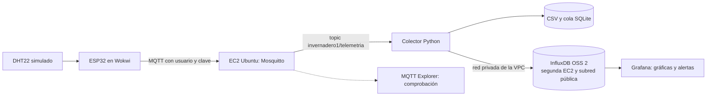

# Práctica 2 | Broker MQTT, InfluxDB y Grafana

**Asignatura:** Inteligencia Artificial Aplicada a Internet de las Cosas
**Docente:** Jhorman Andrés Villanueva Vivas
**Equipo:** Natalia Hernández Piedrahita, Sidney Leonardo Leusson Angulo, José Fernando Luque Cajiao y Jarvin David Alvarado Garcés

Esta carpeta prepara una **segunda implementación** para el mismo caso del invernadero de tomates. La [Práctica 1](../practica-1/README.md) y su Wokwi público se conservan. Aquí el ESP32 simulado usa un broker Mosquitto propio con autenticación; un colector valida cada mensaje, lo deja en CSV y lo escribe en InfluxDB. Grafana lee InfluxDB. Los datos son del simulador, no de un cultivo real.



El dispositivo publica además `invernadero1/temperatura` y `invernadero1/humedad` para que los tópicos de cada variable puedan verse en un cliente MQTT. El colector consume el JSON completo de `invernadero1/telemetria`, identificado por `boot` y `seq`; así evita emparejar por error mensajes independientes. Guarda primero una cola local y el CSV, y reintenta InfluxDB si este se interrumpe. En AWS, InfluxDB corre en una **segunda EC2 Ubuntu dentro de otra subred pública**; su grupo de seguridad admite 8086 únicamente desde el grupo de la primera EC2. Grafana escucha solo en `127.0.0.1` del servidor principal. MQTT 1883 queda abierto temporalmente con autenticación para la demostración simulada.

## Preparación en Ubuntu con Docker

Desde `practica2/`:

```bash
bash setup.sh
docker compose config --quiet
docker compose up -d --build
docker compose ps
```

El script genera claves aleatorias en `.env` y un archivo de contraseñas de Mosquitto en `.secrets/`. Ambos están ignorados por Git. **No compartir capturas de esos valores.** El archivo `.env.example` muestra los nombres de configuración sin claves funcionales. Para acceder a Grafana desde el propio servidor: `http://127.0.0.1:3000`. En la VM de AWS de esta prueba, SSH no está abierto al equipo local. Para verlo desde otro computador con credenciales vigentes de Learner Lab, AWS CLI y el complemento Session Manager, se puede crear un túnel SSM sin abrir el puerto 3000 al público:

MQTT queda limitado a `127.0.0.1` en pruebas locales. Para recibir mensajes de Wokwi en una VM, agregar `MQTT_BIND_HOST=0.0.0.0` al `.env` privado de esa VM y permitir 1883/TCP en su grupo de seguridad durante la demostración.

```bash
aws ssm start-session --target ID_DE_INSTANCIA \
  --document-name AWS-StartPortForwardingSession \
  --parameters '{"portNumber":["3000"],"localPortNumber":["3000"]}'
```

Luego abrir `http://127.0.0.1:3000` en ese computador. El tablero **Savia IoT | Invernadero de tomates** queda aprovisionado; sus cuatro paneles muestran temperatura y humedad del aire interior simulado. En la prueba local, InfluxDB queda en `127.0.0.1:8086`; en AWS, su dirección privada es `10.42.2.106:8086` y no admite conexiones públicas. La clave de Grafana se consulta en el `.env` privado del servidor. Quienes solo tengan el enlace del repositorio no obtienen acceso al panel privado de AWS.

## Configurar el ESP32 de la Práctica 2

La [copia pública de la Práctica 2 en Wokwi](https://wokwi.com/projects/478779944323491841) contiene el ESP32, DHT22, LED de ventilación y código **sin claves**. En el sketch, `MQTT_HOST` y `MQTT_PASSWORD` son marcadores de posición. No introducir la clave de AWS en ese proyecto público: sería visible para quien abra el enlace. Para la demostración real se requiere un medio privado para configurar una clave temporal, probar la conexión y rotarla después. El broker debe ser alcanzable por la pasarela pública de Wokwi; esta modalidad no transporta datos privados ni controla cargas físicas.

En AWS, el servidor principal se amplió a `t3.small` y la base se desplegó en una segunda `t3.micro`, usando la [plantilla de la subred](aws/influx-public-subnet.yaml). La subred tiene ruta a Internet, pero el grupo de seguridad de la base solo admite 8086 desde la EC2 principal; SSH, Grafana e InfluxDB no se abrieron al público. La base PostgreSQL privada de la Práctica 1 conserva su aislamiento. Los detalles observados están en la [evidencia de AWS](EVIDENCIA_AWS_2026-10-24.md).

## Comprobaciones para la entrega

1. `docker compose ps`: en local, cuatro servicios; en AWS, Mosquitto, colector y Grafana en la primera VM, e InfluxDB activo en la segunda.
2. Desde MQTT Explorer, conectar a la IP de AWS en 1883 con el usuario temporal y comprobar `invernadero1/#`. Los mensajes sin usuario/clave deben ser rechazados.
3. Iniciar Wokwi y confirmar `MQTT AWS autenticado` en el monitor serial. Variar temperatura y humedad del DHT22.
4. `docker compose logs --tail=40 collector`: lecturas recibidas y enviadas a InfluxDB. Exportar CSV con `docker compose cp collector:/data/readings.csv ./lecturas-demostracion.csv` (no subir datos privados ni contraseñas).
5. En Grafana, abrir el tablero y verificar los puntos del mismo período. La regla aprovisionada avisa cuando la temperatura supera 30 °C; el contacto publica la notificación en `invernadero1/alertas`. Comprobar que se recibe realmente, además de mirar el estado de la regla. Una futura regla de humedad requerirá su propia prueba antes de presentarla como realizada.
6. Guardar capturas del circuito, MQTT Explorer, CSV, consulta InfluxDB, paneles y alerta/notificación. Compartir el repositorio y exponer el recorrido.

**Estado documentado (24 de octubre de 2026):** la pila se probó [localmente](EVIDENCIA_LOCAL_2026-10-24.md) y se [desplegó en AWS Academy](EVIDENCIA_AWS_2026-10-24.md). Se comprobaron por separado una lectura sintética y un **envío real del ESP32 simulado en Wokwi** al broker propio. El arranque `39c72c8e` produjo siete lecturas en el CSV y catorce puntos de temperatura y humedad, trasladados a la InfluxDB de la segunda VM. Una nueva lectura sintética pasó por MQTT, CSV e InfluxDB después del traslado. Se guardó una [captura real del tablero de Grafana en AWS](evidencias/grafana-aws-2026-10-24.png); la última lectura mostrada allí es sintética. Grafana envió tanto una notificación MQTT de prueba como **una alerta automática** por la lectura sintética alta de `AWSCHECK1792862155`, y ambas se recibieron en AWS. La clave usada en Wokwi fue retirada del proyecto público y rotada en AWS. La [presentación del equipo](https://github.com/nathernandez1189/savia-iot/releases/download/practica-2/Savia_IoT_Practica_2_Presentacion.pptx) está preparada para la sustentación. En CampusDigital se observó cierre de la actividad el **31 de octubre de 2026 a las 12:00** (hora de Colombia); confirmar cualquier cambio directamente en el curso.
